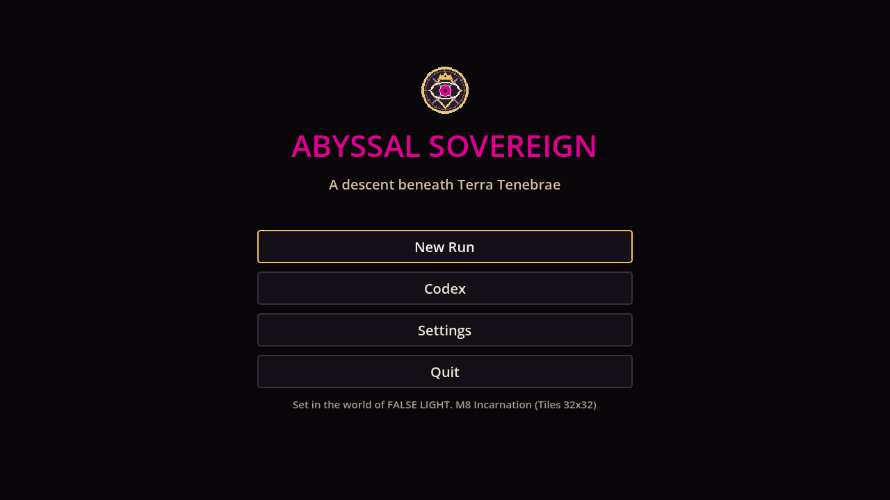
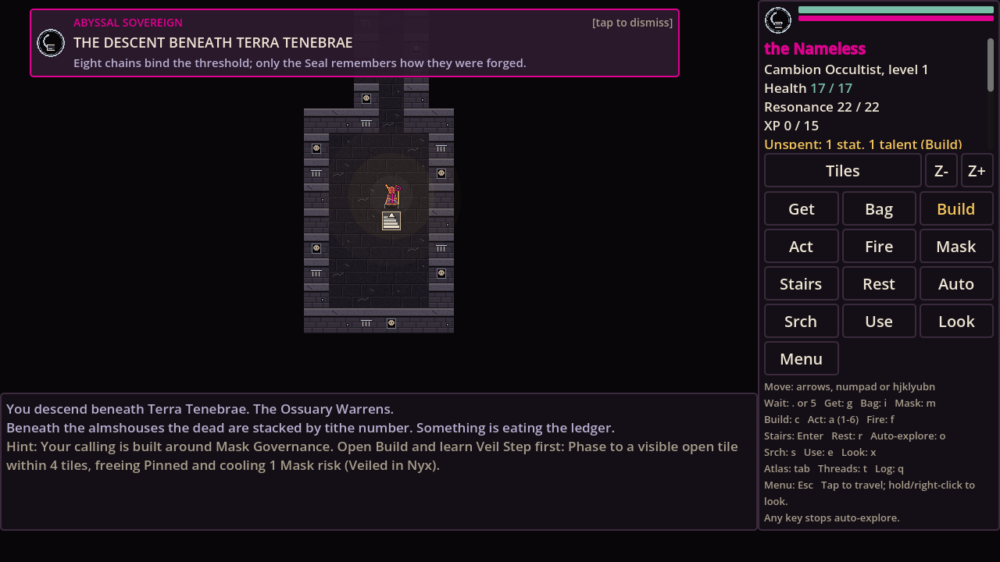
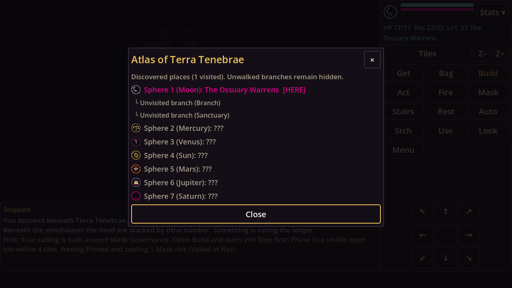
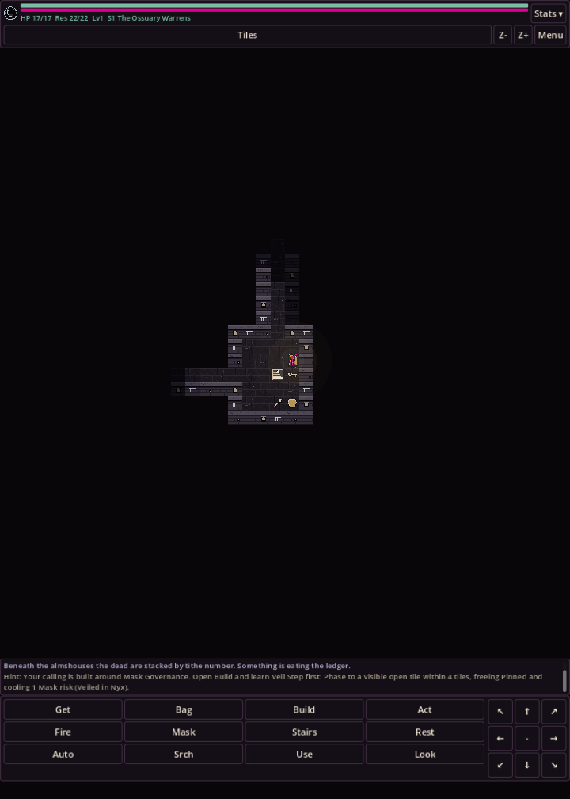

# Abyssal Sovereign (`v1.0.0-rc.1`)

**An original turn-based traditional roguelike set in a sealed, seven-layered labyrinth beneath Terra Tenebrae.**

Abyssal Sovereign combines classical deterministic dungeon crawling, occult-medieval Gnostic theology, multi-faction contracts, and dual graphical/ASCII presentation — built with Godot `4.7.2` to run **100% offline** with zero accounts, ads, subscriptions, or telemetry.

> **Release Candidate Status:** `v1.0.0-rc.1` is published as a [GitHub Pre-Release](https://github.com/sophiashadow/Abyssal-Sovereign/releases/tag/v1.0.0-rc.1) for external human playtesting ([`docs/PLAYTEST.md`](docs/PLAYTEST.md)). Windows desktop execution, Web IndexedDB persistence, physical Android hardware verification, human playtest rounds, external commissioned artwork (`provisional_m9_asset`), and original VENEFICA LUX music stems (`placeholder_liturgical_temp`) remain open prior to final `v1.0.0`.

---

## Download `v1.0.0-rc.1` Pre-Release

Grab portable packages and verify checksums (`SHA256SUMS.txt`) from the [**`v1.0.0-rc.1` Release Page**](https://github.com/sophiashadow/Abyssal-Sovereign/releases/tag/v1.0.0-rc.1):

| Platform | Package | Verification Status | Quick Start |
|---|---|---|---|
| **Linux (`x86_64`)** | `abyssal-sovereign-v1.0.0-rc.1-linux-x86_64.tar.gz` | Automated launch & UI smoke passed (`GL Compatibility`) | Extract tarball, `chmod +x abyssal-sovereign.x86_64`, run `./abyssal-sovereign.x86_64` |
| **Windows (`x86_64`)** | `abyssal-sovereign-v1.0.0-rc.1-windows-x86_64.zip` | Exported — Windows runtime **`NOT_RUN`** | Extract zip and launch `abyssal-sovereign.exe` |
| **Android (`ARMv7`/`ARM64`)** | `abyssal-sovereign-v1.0.0-rc.1-android-debug.apk` | Leak-free APK exported & debug-signed — physical device **`NOT_RUN`** | Sideload APK via `adb install` or Android package installer |
| **Web (`HTML5` / `PWA`)** | `abyssal-sovereign-v1.0.0-rc.1-web.zip` | Exported — browser & IndexedDB runtime **`NOT_RUN`** | Extract and serve over HTTP (`python3 -m http.server 8080`), then open `http://localhost:8080/index.html` |

See [`docs/INSTALL.md`](docs/INSTALL.md) for OS save-directory locations, backup/recovery, upgrades (`v1`–`v12`), and uninstallation.

---

## Screenshots (`v1.0.0-rc.1`)

| Title & Woodcut Crest | Dungeon & Radial Lantern Light |
|---|---|
|  |  |

| Seven Spheres Atlas | Mobile Portrait Touch Interface |
|---|---|
|  |  |

---

## Core Features

- **Deep Character Creation:** `8` Origins × `8` Callings (`64` combinations) and `104` talents across `24` talent trees, including Veil-Touched affinities and Mask stances.
- **Seven Planetary Spheres (`28` Floors):** Descend from *Sphere 1 — Moon* through *Saturn*, spanning `86` monsters (`76` archetypes + `15` Sphere guardians and bosses) and side branches.
- **Occult Ars Moriendi & Gear:** `165` base items, `46` affixes, `12` equipment sets, `26` named artifacts, `16` interactive Relics (repeatable Relic Work vs irreversible Transmutation), and inline `[▲]/[▼]/[?]/[☠]` inventory comparison tags.
- **Living Labyrinth & Contracts:** `18` persistent NPCs, `8` competing institutions, `24` narrative threads, binding Contracts with vows and breaking penalties, and four distinct Victory endings alongside permanent death.
- **Four Difficulty Profiles:** **Initiate**, **Exile** (canonical baseline), **Adversary**, and **Sovereign** — adjusting foe density, squad tightness, elite count, and item cadence without artificial stat multipliers.
- **Dual Presentation & Accessibility:**
  - Switch live between **Tiles** mode (`13` pixel-art atlases, `24` woodcut emblems, radial lantern lighting) and **Glyph** mode (`CP437`-inspired traditional ASCII/symbol rendering).
  - Supports desktop keyboard/mouse (Arrows, Vi-keys, Numpad, rebindable shortcuts), dedicated zero-scroll mobile **Portrait** and **Landscape** touch docks (optional **Left-Handed** flip), collapsible `Stats ▾` drawer, Android Back routing, text/tile scaling, camera zoom, **Reduced Motion**, **Instant Actions**, **High Contrast**, and **Deutan/Protan** + **Tritan** color filters.
- **Offline Liturgical Soundscape:** `47` mastered `44.1 kHz` `.ogg` audio assets across 6 independent volume buses (`Master`, `Music`, `Ambience`, `Combat`, `Interface`, `Narrative`), playable at 100% silent mute.
- **Save Reliability:** Deterministic turn simulation with Save Version `12` and backwards-compatible `v1`–`v12` migrations ([`docs/INSTALL.md`](docs/INSTALL.md)).

---

## Playtesting & Bug Reports

Human playtesting has **not yet been conducted** — external feedback on early balance (especially Depth 2 *The Vault Enumerator*, Occultist/Ophite Binder starts, and Initiate–Sovereign pacing), touch ergonomics, and accessibility modes is actively welcome:

- Read the controls primer, tactical guide, accessibility matrix, and questionnaire in [**`docs/PLAYTEST.md`**](docs/PLAYTEST.md).
- Report bugs or share playtest feedback on [**GitHub Issues**](https://github.com/sophiashadow/Abyssal-Sovereign/issues) (include version, platform/resolution, seed, Origin/Calling, difficulty profile, floor/turn, and reproduction steps).

---

## Building, Testing & Packaging from Source (Godot `4.7.2`)

Requires **Godot `4.7.2.stable`** (`GL Compatibility` renderer). All development and test workflows operate completely offline:

```sh
# Run the full automated unit, determinism, save-migration, content, audio, & asset test suite (214 tests)
./tools/test.sh

# Run full regression + UI smoke across 1280x720, 2340x1080, and 720x1280 + platform exports
./tools/verify.sh --exports

# Export and package portable RC1 archives + SHA256SUMS into build/release/
./tools/package_rc.sh v1.0.0-rc.1
```

Optional tooling in `tools/`:
- `python3 tools/gen_sprites.py` — regenerate sprite atlases, woodcut emblems, and launcher icons.
- `python3 tools/gen_audio.py` — regenerate RMS-mastered offline `.ogg` SFX, ambience loops, and temporary music stems.
- `./tools/m7_run.sh` / `tools/m8_perf_bench.gd` / `tools/ui_smoke.gd` — deterministic balance soaks, benchmarks, and multi-viewport UI verification.

---

## Privacy, Credits & Licenses

- **Privacy:** 100% offline single-player software — zero telemetry, zero analytics, zero ads, and zero accounts. All saves stay local under your OS `user://` directory. See [`docs/release/PRIVACY.md`](docs/release/PRIVACY.md).
- **Engine & Asset Notices:** Powered by Godot Engine `4.7.2` (MIT License). All currently bundled sprites/SFX/ambience (`provisional_m9_asset`) and temporary music stems (`placeholder_liturgical_temp`) are project-original procedural assets with zero unauthorized third-party media. See [`docs/release/CREDITS_AND_LICENSES.md`](docs/release/CREDITS_AND_LICENSES.md).

---

## Documentation Index

- [`docs/INSTALL.md`](docs/INSTALL.md) — Installation, uninstallation, OS `user://` save paths, backup/recovery, and upgrade compatibility
- [`docs/PLAYTEST.md`](docs/PLAYTEST.md) — External human playtest & accessibility guide
- [`docs/release/`](docs/release/) — `RELEASE_NOTES.md`, `PRODUCT_KIT.md`, `PRIVACY.md`, `CREDITS_AND_LICENSES.md`
- [`ARCHITECTURE.md`](ARCHITECTURE.md) & [`DESIGN.md`](DESIGN.md) — Layer boundaries (`core`, `content`, `gen`, `sim`, `persistence`, `ui`), mechanics, and balance findings
- [`ROADMAP.md`](ROADMAP.md), [`docs/M9_REPORT.md`](docs/M9_REPORT.md) & [`docs/RELEASE_CHECKLIST.md`](docs/RELEASE_CHECKLIST.md) — Milestone history, verification results, and open `v1.0.0` release gates
